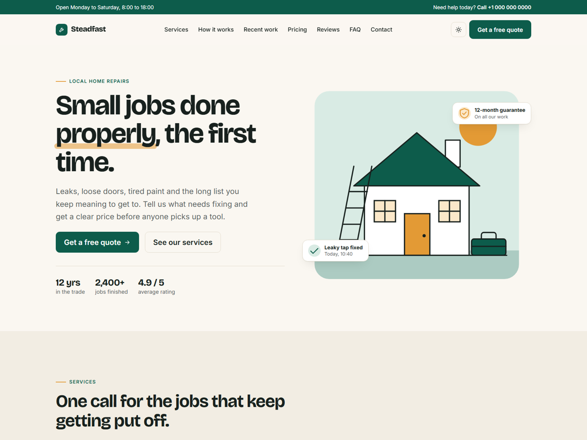

# Steadfast: free Bootstrap 5 template for small service businesses

A one-page website template for trades and local services: plumbers, electricians, handymen, cleaners, gardeners. Replace the text and the colours, and it works for most small businesses that sell their time.



**[Live preview](https://ello-lithuania.github.io/steadfast-bootstrap-template/)** · **[Download ZIP](https://github.com/ello-lithuania/steadfast-bootstrap-template/archive/refs/heads/main.zip)**

## What's included

- Hero with a call to action and an illustrated scene
- Six service cards with starting prices
- Four-step process
- Recent work gallery
- Three pricing plans
- Customer reviews (placeholder text, replace it with your own)
- FAQ accordion
- Contact section with a validated form and a map placeholder
- Light and dark theme, following the system setting with a manual toggle
- Fully responsive, tested from 375 px upwards
- Semantic HTML5, accessible navigation and form labels
- No jQuery and no build step. Bootstrap 5.3.3 is included locally

## Getting started

1. Download the ZIP and unpack it.
2. Open `index.html` in a browser.
3. Edit the text in `index.html`.
4. Change the brand colours at the top of `assets/css/style.css` (the `--sf-*` variables).

## Connecting the contact form

The form only checks its fields in the browser, it does not send anything yet. To receive messages, point it at your own backend or a form service, then adjust the submit handler in `assets/js/main.js`.

## Files

```
index.html                 the page
assets/css/style.css       template styles and colour variables
assets/js/main.js          theme toggle, scroll reveal, form validation
assets/vendor/bootstrap/   Bootstrap 5.3.3 CSS and JS
```

Fonts (Bricolage Grotesque and Inter) load from Google Fonts. All illustrations are inline SVG, so there are no image files to replace unless you want to add your own photos.

## Licence

MIT: free for personal and commercial projects. See [LICENSE](LICENSE). The footer credit is welcome but not required.

## Credits

- [Bootstrap](https://getbootstrap.com/) (MIT)
- [Bricolage Grotesque](https://fonts.google.com/specimen/Bricolage+Grotesque) and [Inter](https://fonts.google.com/specimen/Inter) (SIL Open Font License)

Designed and built by [KokybiskaSvetaine.lt](https://kokybiskasvetaine.lt/), a web studio from Lithuania.
